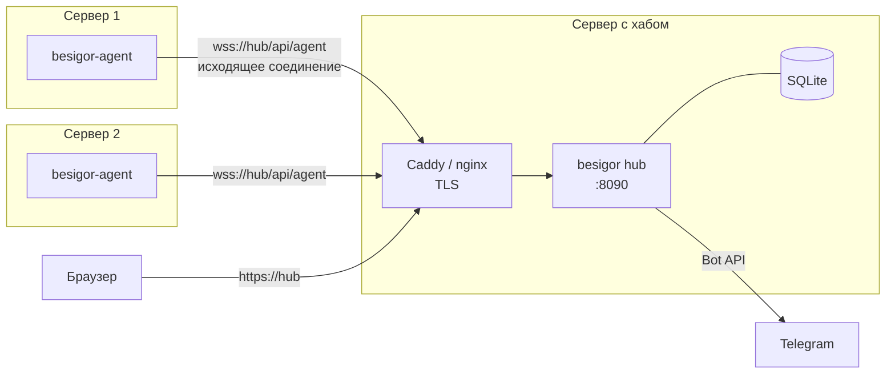
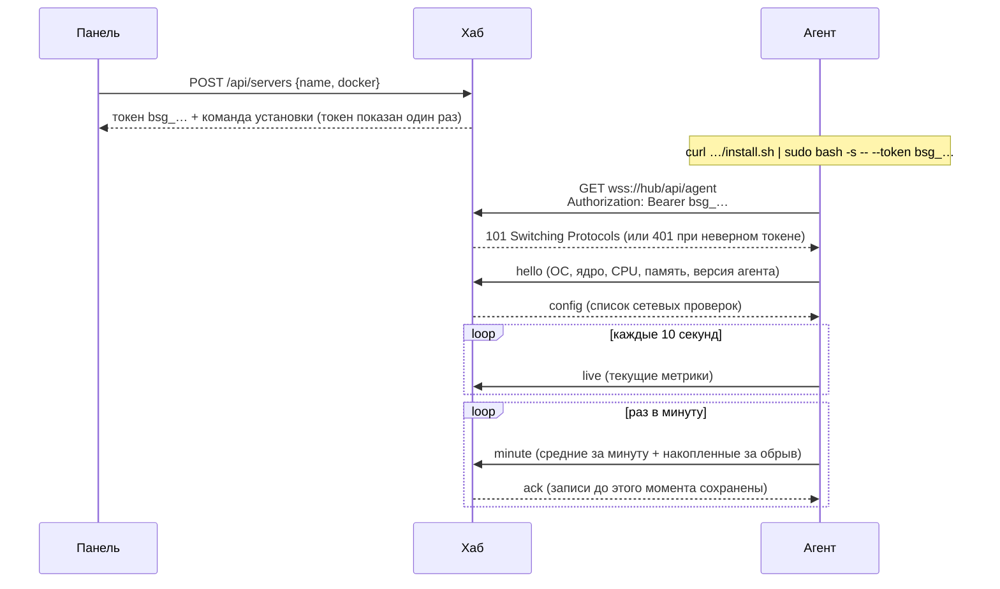

# besigor

Лёгкий самостоятельный мониторинг серверов: хаб с веб-панелью и Telegram-ботом плюс маленький агент на Go на каждом сервере.

Агент **сам подключается к хабу** по защищённому WebSocket, поэтому на наблюдаемых серверах не нужно открывать порты, раздавать SSH-ключи или настраивать фаервол. Новый сервер добавляется одной командой.

- **Метрики:** CPU (user, system, iowait, steal), load average, память и swap, место на всех дисках, дисковый ввод-вывод, сеть по интерфейсам, аптайм. Обновление каждые 10 секунд, история до года.
- **Docker** (по желанию для каждого сервера): все контейнеры, их CPU, память и сеть, health-статус, рестарты, логи вживую прямо из панели.
- **Сетевые проверки с сервера:** ping, TCP-порт, HTTP(S) с контролем срока сертификата, DNS. Время ответа, потери, доступность в процентах.
- **Трафик за месяц:** счётчик по дням, лимит тарифа, день сброса, режим подсчёта провайдера, прогноз на конец периода.
- **Алерты в Telegram:** офлайн, CPU, память, диск, load, трафик, лимит трафика, контейнер упал или перезапускается по кругу, цель проверки недоступна, медленный ответ, потери, истекающий сертификат. Пороги задаются ползунками для каждого сервера.
- **Telegram-бот на кнопках:** общий статус, список серверов, карточка сервера, контейнеры, заглушение алертов на время работ. Уведомления можно разводить по чатам и темам (тредам).
- **Тёмная адаптивная панель,** удобная и с телефона.

Агент весит около 16 МБ и потребляет около 10 МБ памяти. Он только читает данные и ничего не меняет на сервере.

---

## Содержание

- [Как это устроено](#как-это-устроено)
- [Как подключаются серверы](#как-подключаются-серверы)
- [Требования](#требования)
- [Установка хаба](#установка-хаба)
- [Добавление серверов](#добавление-серверов)
- [Telegram-уведомления](#telegram-уведомления)
- [Алерты](#алерты)
- [Сетевые проверки, контейнеры, трафик](#сетевые-проверки-контейнеры-трафик)
- [Обновление](#обновление)
- [Удаление](#удаление)
- [Данные и резервные копии](#данные-и-резервные-копии)
- [Переменные окружения](#переменные-окружения)
- [Решение проблем](#решение-проблем)
- [Разработка](#разработка)

---

## Как это устроено



| Компонент | Что делает |
|---|---|
| **Хаб** (`ghcr.io/igorp0tatoes/besigor-hub`) | Node.js-сервис в одном контейнере: веб-панель, REST API, приём агентов по WebSocket, хранение метрик в SQLite, движок алертов, Telegram-бот. Слушает один HTTP-порт, по умолчанию `8090`. TLS не делает сам, для этого нужен обратный прокси перед ним. |
| **Агент** (`ghcr.io/igorp0tatoes/besigor-agent`) | Go-бинарник в distroless-контейнере. Читает метрики из `/proc` и `/sys` хоста, по желанию из Docker API, выполняет сетевые проверки и отправляет всё хабу. Входящих соединений не принимает. |
| **Прокси** | Caddy, nginx, Traefik или что угодно: завершает HTTPS и пропускает WebSocket. Готовые конфиги лежат в [`deploy/proxy`](deploy/proxy); есть и вариант со встроенным Caddy. |

Образы собираются для `linux/amd64` и `linux/arm64`.

---

## Как подключаются серверы

### Коротко

1. В панели нажимаете «Добавить сервер», вводите имя и выбираете, давать ли агенту доступ к Docker.
2. Хаб создаёт для сервера уникальный токен и показывает готовую команду установки.
3. Выполняете команду на сервере. Агент запускается и **сам** открывает соединение к хабу.
4. Через несколько секунд сервер появляется в панели «в сети».

### Подробно



**Токен.** На каждый сервер выпускается свой случайный токен вида `bsg_…` (192 бита). Хаб хранит только его SHA-256, а сам токен показывает один раз, в момент выпуска. Удаление сервера в панели или выпуск нового токена сразу отключает текущего агента и делает старый токен недействительным. Если токен потерян, на странице сервера нажмите «Новый токен» и выполните на сервере показанную команду.

**Соединение.** Агент открывает обычное исходящее HTTPS-соединение на `https://<хаб>/api/agent` и переключает его на WebSocket. Поэтому:
- на наблюдаемом сервере не нужно открывать ни одного порта;
- достаточно, чтобы сервер мог ходить наружу на 443-й порт хаба;
- работает за NAT, за CGNAT и из закрытых сетей.

**Поддержание связи.** Хаб каждые 20 секунд шлёт ping. Если агент молчит 45 секунд, соединение считается мёртвым. Агент со своей стороны каждые 30 секунд проверяет связь своим ping. При обрыве агент переподключается с растущей паузой: 1 с, 2 с, 4 с… до 60 с, со случайным разбросом ±20 %, чтобы после перезапуска хаба все агенты не ломились одновременно. Если хаб ответил `401` (токен отозван), агент пробует снова раз в минуту. Если с тем же токеном подключился второй агент, побеждает новое соединение.

**Без потерь при обрыве.** Средние за каждую минуту агент считает сам и держит в памяти, пока хаб не подтвердит их сохранение (`ack`). Если связь пропала, агент копит минутные записи до одного часа и после переподключения досылает их, поэтому на графиках не будет дыр. Повторно присланные записи хаб распознаёт и не учитывает дважды, в том числе в счётчике трафика.

**Что агент читает и зачем ему эти права:**

| Настройка контейнера агента | Зачем |
|---|---|
| `network_mode: host` | видеть сетевые интерфейсы и трафик хоста, а не контейнера |
| `pid: host` | читать `/proc` хоста, в частности список смонтированных дисков |
| `/:/host:ro` | посчитать занятое место на разделах хоста (только чтение) |
| `/var/run/docker.sock:ro` | **только если включён доступ к Docker:** список контейнеров, их статистика и логи |
| `cap_add: NET_RAW` | отправлять ICMP-пакеты для ping-проверок |
| `no-new-privileges` | запрет повышения привилегий внутри контейнера |

`privileged` агенту не нужен. Агент обращается к Docker API только на чтение (`/containers/json`, `/containers/{id}/json`, `/stats`, `/logs`) и не умеет запускать, останавливать или удалять контейнеры. В панели и боте таких действий тоже нет. Логи контейнера агент читает, только пока в панели открыто окно «Логи», и хаб их не сохраняет. Если доступ к Docker для сервера выключен, сокет в контейнер агента не монтируется, а хаб ещё и сам отклоняет запросы логов для этого сервера.

**Сетевые проверки** выполняет агент того сервера, к которому они добавлены. Список проверок хаб присылает агенту сообщением `config` при подключении и при каждом изменении. Результаты копятся у агента и тоже досылаются после обрыва.

Полное описание формата сообщений: [docs/protocol.md](docs/protocol.md).

---

## Требования

**Сервер для хаба:**
- Linux, Docker 20.10+ с плагином `docker compose`;
- домен (A-запись на этот сервер) для HTTPS;
- 1 vCPU, от 256 МБ свободной памяти, около 200 МБ на диске для истории 10 серверов за год.

**Наблюдаемые серверы:**
- Linux x86_64 или arm64. Docker скрипт установки поставит сам, если его нет;
- исходящий доступ на 443-й порт хаба.

---

## Установка хаба

Ниже пример для домена `monitor.example.com`, замените его на свой.

### 1. DNS

Создайте A-запись `monitor.example.com` → IP сервера с хабом. Если используете Cloudflare, начните с режима «DNS only» (серое облако). Проксирование через Cloudflare тоже работает, см. [`TRUST_CLOUDFLARE`](#переменные-окружения).

### 2. Файлы

```bash
sudo mkdir -p /opt/besigor && cd /opt/besigor
sudo curl -fsSLo docker-compose.yml https://raw.githubusercontent.com/IgorP0tatoes/besigor/main/deploy/hub/docker-compose.yml
sudo curl -fsSLo .env https://raw.githubusercontent.com/IgorP0tatoes/besigor/main/deploy/hub/.env.example
```

### 3. Настройки

Откройте `.env` и заполните:

```bash
APP_URL=https://monitor.example.com   # публичный адрес панели, попадёт в команду установки агента
ADMIN_USER=admin
ADMIN_PASSWORD=                       # длинный случайный пароль: openssl rand -base64 24
```

Сгенерировать и сразу записать пароль можно так:

```bash
sudo sed -i "s|^ADMIN_PASSWORD=.*|ADMIN_PASSWORD=$(openssl rand -base64 24 | tr -d '/+=')|" .env
sudo chmod 600 .env
grep ADMIN_PASSWORD .env   # запомните пароль
```

### 4. Запуск и HTTPS

Выберите один из вариантов.

<details open>
<summary><b>Вариант A. На сервере уже есть свой Caddy или nginx</b></summary>

Хаб слушает `127.0.0.1:8090`:

```bash
sudo docker compose up -d
```

**Caddy.** Добавьте в Caddyfile блок из [`deploy/proxy/Caddyfile.example`](deploy/proxy/Caddyfile.example) и перезагрузите Caddy:

```caddy
monitor.example.com {
	encode zstd gzip
	reverse_proxy 127.0.0.1:8090 {
		flush_interval -1
	}
}
```

**nginx.** Возьмите [`deploy/proxy/nginx.conf.example`](deploy/proxy/nginx.conf.example). Главное в нём — заголовки `Upgrade`/`Connection` для WebSocket, `proxy_buffering off` для живых обновлений панели и длинные таймауты:

```nginx
location / {
    proxy_pass http://127.0.0.1:8090;
    proxy_http_version 1.1;
    proxy_set_header Upgrade $http_upgrade;
    proxy_set_header Connection $connection_upgrade;
    proxy_set_header Host $host;
    proxy_set_header X-Forwarded-For $proxy_add_x_forwarded_for;
    proxy_set_header X-Forwarded-Proto $scheme;
    proxy_read_timeout 3600s;
    proxy_buffering off;
}
```

**Прокси сам работает в Docker** (например, в общей сети с другими сервисами). Тогда вместо проброса порта подключите хаб к сети прокси и обращайтесь к нему по имени контейнера `besigor:8090`:

```yaml
services:
  besigor:
    # …как в docker-compose.yml, но без ports:
    networks: [proxy]
networks:
  proxy:
    external: true   # имя сети вашего прокси
```

</details>

<details>
<summary><b>Вариант B. Чистый сервер: встроенный Caddy сам получит сертификат</b></summary>

Порты 80 и 443 должны быть свободны.

```bash
sudo curl -fsSLo docker-compose.yml https://raw.githubusercontent.com/IgorP0tatoes/besigor/main/deploy/hub/docker-compose.caddy.yml
echo "DOMAIN=monitor.example.com" | sudo tee -a .env
sudo docker compose up -d
```

</details>

### 5. Вход

Откройте `https://monitor.example.com` и войдите с `ADMIN_USER` и `ADMIN_PASSWORD`. Пять неверных попыток с одного IP блокируют вход с него на 15 минут. При массовом переборе с разных адресов вход временно закрывается для всех.

Проверить, что хаб жив: `curl https://monitor.example.com/api/health`.

---

## Добавление серверов

### Одной командой (рекомендуется)

1. В панели: **«+ Добавить сервер»**, введите имя и выберите режим:
   - **С доступом к Docker:** контейнеры, их нагрузка, логи, алерты по контейнерам;
   - **Без Docker:** только метрики сервера и сетевые проверки.
2. Скопируйте показанную команду и выполните её на сервере:

```bash
curl -fsSL https://monitor.example.com/install.sh | sudo bash -s -- --token bsg_xxxxxxxxxxxxxxxxxxxxxxxxxxxxxxxx
```

Скрипт:
1. проверяет, что запущен от root на Linux, и проверяет формат токена;
2. ставит Docker официальным скриптом `get.docker.com`, если его нет;
3. создаёт `/opt/besigor-agent/docker-compose.yml` с адресом хаба и токеном (права `600`, читает только root);
4. скачивает образ агента той же версии, что и хаб, и запускает контейнер `besigor-agent` (`restart: unless-stopped`, логи ограничены 10 МБ);
5. ждёт до 30 секунд строку `connected to hub` и сообщает результат. Если хаб не принял токен или недоступен, скрипт покажет понятную ошибку и последние строки лога агента.

Скрипт сам по себе не содержит секретов: токен передаётся аргументом. Посмотреть, что именно он делает, можно до запуска: `curl -fsSL https://monitor.example.com/install.sh | less`.

Параметры скрипта:

| Параметр | Что делает |
|---|---|
| `--token bsg_…` | токен сервера из панели (обязателен для установки) |
| `--no-containers` | не давать агенту доступ к Docker (панель добавляет его сама, если выбран режим «Без Docker») |
| `--uninstall` | остановить и удалить агента |

### Вручную через docker-compose

В том же окне панели есть спойлер «Вручную через docker-compose» с готовым файлом. Положите его в любую папку и выполните `docker compose up -d`. Эталонный файл: [`deploy/agent/docker-compose.yml`](deploy/agent/docker-compose.yml).

### Без Docker на сервере

Агент — один статический бинарник. Его можно собрать (`cd agent && go build ./cmd/besigor-agent`) и запустить как службу systemd с переменными `HUB_URL` и `TOKEN`. В этом случае `HOST_ROOT` задавать не нужно.

### Проверка

```bash
docker logs besigor-agent --tail 5    # ожидается: connected to hub
docker run --rm --pid host --network host -v /:/host:ro ghcr.io/igorp0tatoes/besigor-agent sample
```

Команда `sample` один раз собирает метрики и печатает то, что агент отправил бы хабу. Удобно, чтобы проверить, какие диски и интерфейсы он видит.

---

## Telegram-уведомления

1. Создайте бота у [@BotFather](https://t.me/BotFather) (`/newbot`) и скопируйте токен.
2. В панели откройте **«Уведомления» → «Telegram-бот»**, вставьте токен и нажмите «Сохранить». Появится статус `🟢 @имя_бота`.
3. Напишите боту `/start` в нужном месте: в личке, в группе или в теме (треде) группы. Бот ответит, что чат не подключён, и покажет его `chat_id`.
4. Этот чат появится в панели в блоке **«Новые чаты»**. Нажмите «Добавить», выберите категории и сохраните. Название подтянется из Telegram.
5. Кнопка «Тест» отправит проверочное сообщение.

Категории позволяют развести уведомления, например так: тема «Аварии» получает «Офлайн» и «Контейнеры», тема «Ресурсы» получает остальное.

| Категория | Что входит |
|---|---|
| Офлайн и восстановление | сервер пропал и вернулся |
| Ресурсы | CPU, память, диск, load average |
| Трафик | скорость трафика, месячный лимит |
| Контейнеры | контейнер остановился, рестарт по кругу |
| Сетевые проверки | недоступность, время ответа, потери, сертификаты |

**Меню бота.** По команде `/menu` открывается меню на кнопках: «📊 Общий статус», «🖥 Серверы» → карточка сервера («🔄 Обновить», «🐳 Контейнеры», «🔕 Заглушить» на 1 ч, 4 ч, 24 ч или до включения), «🔔 Алерты». Сообщение обновляется на месте и не засоряет чат. Есть также команды `/status`, `/servers` и `/alerts`. Бот отвечает только в чатах из списка получателей, на сервере ничего не выполняет и работает через long polling, так что публичный вебхук не нужен.

---

## Алерты

Настраиваются на странице сервера в блоке «Алерты»: переключатель плюс ползунки «порог» и «сколько держится». Кнопка «Ко всем» копирует настройку на все серверы. Новые серверы получают значения по умолчанию. Метрики сравниваются со **средним** за выбранное окно, поэтому короткие пики не будят по ночам. Когда проблема уходит, приходит сообщение «✅ …в норме».

| Алерт | По умолчанию | Включён |
|---|---|---|
| Сервер не в сети | дольше 2 мин | да |
| Диск (самый заполненный раздел) | > 90 % · 5 мин | да |
| Память (без учёта кэша) | > 90 % · 10 мин | да |
| Процессор | > 90 % · 10 мин | нет |
| Load average (на одно ядро) | > 2 · 10 мин | нет |
| Сетевой трафик (вход + выход) | > 100 Мбит/с · 10 мин | нет |
| Месячный лимит трафика | 80 % и 95 % | да (если задан лимит) |
| Контейнер остановился | 1 мин | да |
| Рестарты контейнера | ≥ 3 за 10 мин | да |
| Цель проверки недоступна | 3 неудачи подряд | да |
| Сертификат истекает | < 14 дней | да |
| Время ответа проверки | > 500 мс · 5 мин | нет |
| Потери пакетов | > 20 % · 5 мин | нет |

Заглушение (на странице сервера или в боте) отключает уведомления по серверу, но состояние алертов продолжает отслеживаться.

---

## Сетевые проверки, контейнеры, трафик

**Сетевые проверки.** На странице сервера нажмите «+ Проверка» и выберите тип:
- **Ping:** три ICMP-пакета, среднее время и потери;
- **TCP:** удалось ли открыть соединение с портом и за сколько;
- **HTTP(S):** ответ сайта (коды 4xx и 5xx считаются ошибкой, редирект нет) и срок сертификата;
- **DNS:** резолвится ли имя, по желанию через указанный DNS-сервер.

Можно ввести сразу несколько целей, по одной в строке, и для каждой создастся своя проверка. Для TCP у цели можно указать свой порт: `host:8443`. Интервал задаётся в секундах, от 10 до 3600. Проверка идёт **с этого сервера**, поэтому видно, как, например, нода в Германии видит вашу панель.

**Контейнеры.** В таблице на странице сервера: состояние и health, CPU (в процентах от всего хоста), память без учёта кэша, сеть, рестарты, аптайм. Кнопка «Логи» показывает последние 300 строк и дальше подгружает новые вживую. На графиках показаны 6 самых нагруженных контейнеров.

**Трафик за месяц.** Карточка на странице сервера: сколько израсходовано, разбивка ↓/↑, столбики по дням, прогноз на конец периода. Кнопка «Лимит» задаёт лимит тарифа (ГБ или ТБ), день сброса (1–28) и способ подсчёта у провайдера: «вход + выход», «только исходящий» или «больший из двух». В итог идут только физические интерфейсы: туннели (`wg*`, `tun*` и т. п.) не удваивают трафик.

---

## Обновление

**Хаб.** Тег образа задаётся в `.env` переменной `BESIGOR_TAG`: по умолчанию `latest`, но можно закрепить конкретный релиз, например `BESIGOR_TAG=0.2.3`.

```bash
cd /opt/besigor
sudo docker compose pull && sudo docker compose up -d
```

Миграции базы выполняются автоматически при старте.

**Агенты.** Панель подсвечивает серверы, где версия агента старше версии хаба. Обновить агента можно двумя способами:
- на странице сервера «Новый токен» и выполнить на сервере показанную команду (она же переустанавливает агента);
- или вручную на сервере: поменять тег образа в `/opt/besigor-agent/docker-compose.yml` и выполнить `docker compose pull && docker compose up -d`.

Автоматического обновления агентов нет намеренно: обновлять все серверы разом без вашего ведома рискованно.

---

## Удаление

**Агент:**

```bash
curl -fsSL https://monitor.example.com/install.sh | sudo bash -s -- --uninstall
```

Затем удалите сервер в панели: «Удалить» на странице сервера стирает его историю и отзывает токен.

**Хаб:**

```bash
cd /opt/besigor && sudo docker compose down -v   # -v удалит и все данные
```

---

## Данные и резервные копии

Все данные хаба лежат в томе `besigor-data` (`/data` в контейнере): база `besigor.db` (SQLite), секрет сессий и папка `backups`.

| Что | Сколько хранится |
|---|---|
| Метрики с шагом 1 минута | 7 дней |
| Метрики с шагом 15 минут | 90 дней |
| Метрики с шагом 1 час | 1 год |
| Проверки: 1 минута / 1 час | 7 дней / 1 год |
| Трафик по дням | ~13 месяцев |

Раз в сутки хаб сам делает согласованную копию базы в `/data/backups` и хранит последние 7. Чтобы перенести хаб, скопируйте том или файл копии, положите его как `besigor.db` в новый том и запустите хаб.

```bash
# скопировать последние копии базы на хост
docker cp besigor:/data/backups ./besigor-backups
```

---

## Переменные окружения

### Хаб

| Переменная | По умолчанию | Описание |
|---|---|---|
| `ADMIN_PASSWORD` | — | **обязательно**, пароль входа в панель |
| `ADMIN_USER` | `admin` | логин |
| `APP_URL` | из заголовков запроса | публичный адрес хаба, подставляется в команду установки агента. Лучше задать явно |
| `PORT` | `8090` | порт HTTP |
| `HOST` | `0.0.0.0` | адрес, на котором слушать |
| `DATA_DIR` | `/data` | папка с базой и копиями |
| `TRUSTED_PROXIES` | локальные и частные сети | адреса прокси, которым можно верить в `X-Forwarded-For` (через запятую, IP или CIDR) |
| `TRUST_CLOUDFLARE` | `false` | `true`, если хаб за прокси Cloudflare (оранжевое облако): реальный IP посетителя берётся из `CF-Connecting-IP`. Без прокси Cloudflare не включайте, иначе заголовок можно подделать |
| `SESSION_SECRET` | генерируется и сохраняется в `DATA_DIR` | ключ подписи cookie |
| `TELEGRAM_BOT_TOKEN` | — | токен бота, если не хотите вводить его в панели |
| `AGENT_IMAGE` | `ghcr.io/igorp0tatoes/besigor-agent` | образ агента для команды установки |
| `TZ` | `Europe/Moscow` | часовой пояс времени в сообщениях бота |
| `LOG_LEVEL` | `info` | `debug`, `info`, `warn`, `error` |
| `BESIGOR_TAG` | `latest` | тег образа хаба в `docker-compose.yml` (читается только compose) |

### Агент

| Переменная | По умолчанию | Описание |
|---|---|---|
| `HUB_URL` | — | **обязательно**, адрес хаба: `https://monitor.example.com` (путь `/api/agent` добавится сам) |
| `TOKEN` / `TOKEN_FILE` | — | **обязательно**, токен сервера или путь к файлу с ним |
| `HOST_ROOT` | `/host` в образе | куда смонтирован корень хоста; на голом сервере пусто |
| `HOST_PROC`, `HOST_SYS` | `/proc`, `/sys` | пути к procfs и sysfs |
| `DOCKER_HOST` | `/var/run/docker.sock` | сокет Docker; пустое значение выключает контейнеры |
| `LOG_LEVEL` | `info` | уровень логов |

---

## Решение проблем

**Сервер не появляется в панели.** Посмотрите `docker logs besigor-agent --tail 20`.
- `token rejected by hub (401)`: токен неверный или отозван. На странице сервера «Новый токен», выполните команду заново.
- `failed to WebSocket dial` или `no such host`: сервер не достаёт до хаба. Проверьте `curl -sI https://monitor.example.com/api/health` с этого сервера, DNS и исходящий доступ на 443.
- Ошибка рукопожатия за nginx: проверьте заголовки `Upgrade`/`Connection` в конфиге прокси.

**Панель не обновляется в реальном времени.** Прокси буферизует поток событий. Для nginx нужен `proxy_buffering off`, для Caddy `flush_interval -1`.

**Неправильный трафик или «лишние» интерфейсы.** В итог идут интерфейсы с физическим устройством. Туннели видны отдельно на графике «Интерфейсы». Агенту нужен `network_mode: host`.

**Не видно какого-то диска.** Агент показывает реальные файловые системы (ext4, xfs, btrfs, zfs…) и пропускает `/boot`, `/snap`, служебные каталоги Docker. Проверьте вывод `… besigor-agent sample`.

**Ping-проверка пишет «raw socket (нужен NET_RAW)».** В контейнере агента нет `cap_add: [NET_RAW]`.

**Логи контейнера не открываются.** Для сервера выключен доступ к Docker. Включить его можно через «Новый токен», выбрав «С доступом к Docker».

**Забыли пароль.** Поменяйте `ADMIN_PASSWORD` в `.env` и выполните `docker compose up -d`.

---

## Разработка

```
agent/            Go-агент: метрики (/proc, /sys), Docker, сетевые проверки, WebSocket-клиент
hub/server/       Node.js 22 + TypeScript: Fastify, ws, better-sqlite3, алерты, Telegram
hub/web/          панель: React + Vite + uPlot
deploy/           compose-файлы хаба и агента, примеры конфигов Caddy и nginx
docs/protocol.md  протокол агент ↔ хаб
```

Сборка и тесты (нужен только Docker):

```bash
# агент
docker run --rm -v "$PWD/agent":/src -w /src golang:1.27-alpine go test ./...
docker build -t besigor-agent:dev agent

# хаб
docker run --rm -v "$PWD/hub/server":/app -w /app node:22-slim sh -c 'npm ci --ignore-scripts && npm test'
docker build -t besigor-hub:dev hub
```

Локальный запуск хаба: `docker run --rm -p 8090:8090 -e ADMIN_PASSWORD=dev besigor-hub:dev`, затем откройте `http://localhost:8090`.

Релиз: тег `vX.Y.Z` запускает GitHub Actions. Тесты, затем мультиархитектурные образы в GHCR с тегами `X.Y.Z`, `X.Y` и `latest`.
